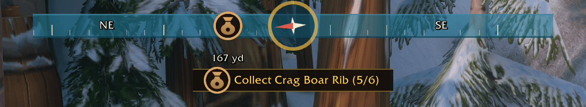
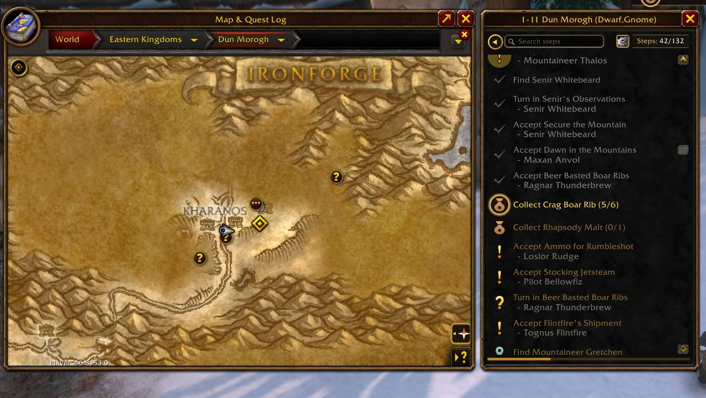
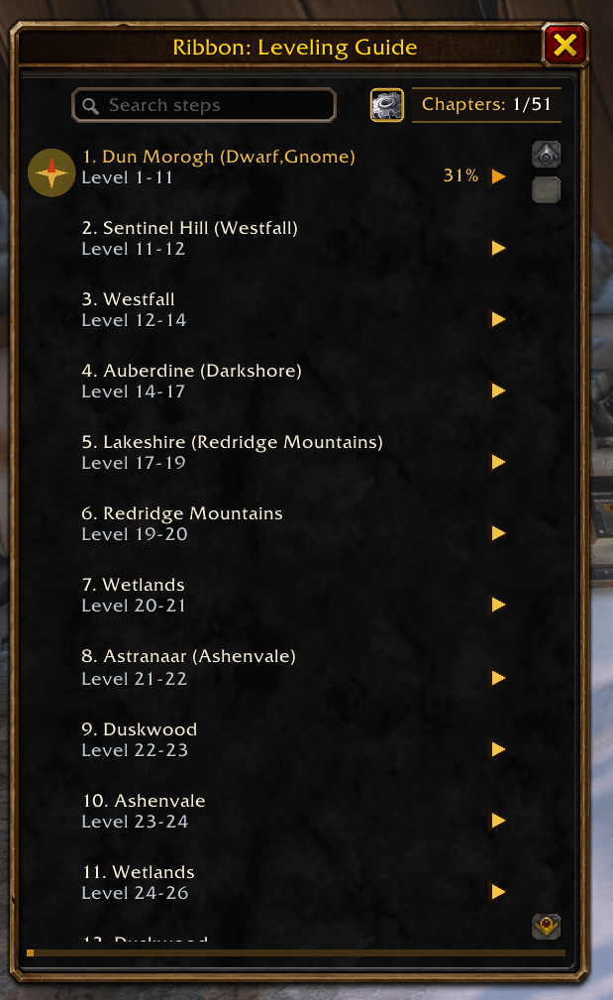

<p align="center">
  
</p>

# Ribbon

Ribbon shows where your destination is on a compass bar at the top of your screen, and on the world map and minimap. It works with your quests, RestedXP, TomTom and your own waypoints, and other addons can send it waypoints too.

Built for the Forever beta client; also runs on Classic Era (1.15), where the in-world marker is unavailable (the client has no user waypoints) and the tracked quest is the first one watched in the quest tracker.

<p align="center">
  
</p>

<p align="center"><em>The compass: waypoint markers on the bar, the compass dial in the middle, the distance and step text under it.</em></p>

<p align="center">
  
</p>

<p align="center"><em>The guide panel beside the world map: steps laid out like the quest log, done steps checked, the current step highlighted.</em></p>

<p align="center">
  
</p>

<p align="center"><em>The chapter list, with each chapter's levels and your progress through the guide.</em></p>

## Features

- **Compass ribbon:** a heading bar with a marker for each waypoint, and a compass dial in the middle of it whose needle always points to due north (hover the dial to see your coordinates, zone and heading; click it to open the guide). The markers pass over the dial; the direction names and the degree ticks stay under it. Under the bar, on a dark plate that stays readable over any scenery, you see the name and distance of the nearest (or focused) waypoint and a short description of what to do there.
- **Distance at a glance:** markers shrink as they get farther and grow as you close in. A waypoint close by is drawn taller than the ribbon itself, a distant one is small (never smaller than 18 px). A waypoint outside your field of view is held inside the end of the bar with an arrow pointing the way to turn. The direction labels (N, NE, ...) are outlined and shadowed so they stand out.
- **Map and minimap pins:** your waypoints drawn on the world map and minimap.
- **Guide player:** step-by-step guides in a searchable chapter and step panel with progress bars, filtered to your class and race. Grind kill counts persist through reloads (see `/ribbon guides` below).
- **Guide options:** auto-advance, auto accept and turn-in (hold Shift to skip), objective dots and an in-world marker. All are on by default (see Guide player below).
- **Tracked quest:** the quest you track in the game shows on the compass as a diamond badge: a sword for a kill objective, a bag for an item objective, a quest icon for a turn-in or anything else, and the pick-up icon for a quest you can accept.
- **RestedXP:** the waypoint RXPGuides is pointing its arrow at shows on the compass as RXP's navigation arrow. Under the bar you see what the step says to do ("Kill Sharptusk Thornmantle (0/1)") rather than the step number, and it updates as you progress.
- **TomTom:** waypoints set through TomTom, including `/way`, show on the compass using the map dot from your TomTom theme.

RestedXP and TomTom keep drawing their own arrows and map icons. Ribbon only reads what they point at, so nothing changes for them.

## Guide player

Open it with `/ribbon guides`, the Ribbon button above the map, or by clicking the compass dial. The cog in the search row holds the options, all on by default:

- **Auto-advance:** moves to the next step when the quest log shows the step is done.
- **Auto accept and turn in:** accepts quests and hands in finished ones that have no reward to choose from. Hold Shift to skip.
- **Objective locations:** red dots on the map and minimap where the current step's creatures and objects are.
- **In-world marker:** the current step's badge in the 3D view, smaller and higher the farther it is. It lifts by the height difference when the step carries a height.

What the player does for you:

- **Route on the map:** pins for the next two steps with a dashed line through them. The line stays while you hover a step and passes over level-up steps.
- **Steps that complete themselves:** a trainer step when the trainer window opens, a flight path step when you open a nearby flight master's map or learn the path, an inn step when your hearthstone is bound there, a hearth step when you reach the innkeeper.
- **Grinds:** kills are counted from the XP chat line and survive a reload. A grind with an XP gate ends as soon as you reach its level and XP, and shows the route's estimate, like "Kill Avala (3/~8)".
- **Panel placement:** it docks beside a quest or gossip window, else the open map, else the left of the screen, and hides while other game panels are open. The quest log key opens it.

## Install

1. Copy the `src` folder into your game's `Interface\AddOns` folder.
2. Rename it to `Ribbon`, so you have `Interface\AddOns\Ribbon\Ribbon.toc`.
3. Restart the game. (A `/reload` is not enough for new files.)

Ribbon works on its own: it bundles HereBeDragons for map pins (a newer copy from RestedXP or TomTom is shared if present). RestedXP and TomTom are read only if they are installed.

## Using it

| Command | What it does |
| --- | --- |
| `/ribbon [zone] <x> <y> [description]` | Set a waypoint, for example `/ribbon Stormwind City 49.5 71 Auction House`. Without a zone it uses the one you are in. |
| `/ribbon clear` | Hide every waypoint. |
| `/ribbon show` | Bring hidden waypoints back. |
| `/ribbon list` | List your waypoints with distances. |
| `/ribbon remove <number>` | Remove one waypoint (the number is shown in `list`). |
| `/ribbon compass [show\|hide\|toggle\|lock\|unlock\|reset]` | Show, hide, lock or reset the compass. |
| `/ribbon compass width <500-800>` | Set the bar width. |
| `/ribbon compass opacity <20-100>` | How see-through the ribbon is, as a percentage (default 60). Text, markers and the caption stay solid. |
| `/ribbon compass dial <20-100>` | How see-through the compass dial is, as a percentage (default 70). Its needle stays solid. |
| `/ribbon compass fov <90-180>` | Set how wide an angle the bar covers. |
| `/ribbon guides` | With a guide installed, open the guide panel beside the world map (opening the map too), on the steps of the chapter you are in. Steps are laid out like quests in the quest log, a gold title, the rest of what the step says as objectives under it, and a check mark in place of its icon once it is done; steps still to come are dimmed until you hover them. Each step has the icon of what it asks for. Click the step to preview it on the world map (the map switches to its zone and centres on it); hover it and its icon takes the current step's gold glow, and clicking the icon makes it your current step. Beside the search box a count shows where you are ("Steps: 3/80" in a chapter, "Chapters: 4/55" on the list). The search box at the top narrows both the chapters and the steps as you type (the steps of every chapter that match, each chapter under a section header of its own), forgiving typos and missing letters (crssrods finds Crossroads). The back arrow goes to the list of chapters, each with its levels and a progress bar. Your progress through the whole guide is a thin loader bar along the bottom of the map button; hover the button, or a chapter, for the percentage. The same panel opens from the blue Ribbon button above the map's quest log toggle, or by clicking the compass dial in the middle of the ribbon. It reopens next session if you left it open. |

- Drag the compass to move it. `/ribbon compass lock` stops the compass moving.
- Left-click a marker on the compass to focus it: it grows and its name and distance show under the bar. Click it again to go back to the nearest waypoint.
- Right-click any marker or pin to hide that waypoint everywhere.
- The world map has a **Clear Pins** button that hides every pin.
- Waypoints on another continent are not shown on the compass.

### Troubleshooting

- `/ribbon debug` prints your position as the addon reads it.
- `/ribbon probe` reports which client APIs Ribbon found and how the map layers. Include it in a bug report.
- `/ribbon tomtom` and `/ribbon rxp` show whether TomTom or RestedXP was found and what Ribbon is mirroring from it.
- If Ribbon says it is dormant, the game client is missing an API it needs; the message names it.

## For addon authors

Send Ribbon waypoints from your own addon:

```lua
local uid = Ribbon:AddWaypoint(uiMapID, x, y, {
  title = "Anvil Mar",            -- display name
  description = "Buy a new hammer",  -- short text shown under the bar (up to two lines)
  icon = "turnin",                -- accept, turnin, kill, loot, grind, poi
  minimap = true, worldmap = true, compass = true,   -- where to draw it (default true)
  arrival_distance = 5,           -- yards (default 5)
  on_arrive = function(uid) end,  -- called once when the player arrives
  lines = { "Quest giver" },      -- extra tooltip lines
})
Ribbon:RemoveWaypoint(uid)
Ribbon:ClearAllWaypoints()
Ribbon:SetWaypointVisible(uid, false)
Ribbon:SetFocus(uid)              -- caption this waypoint instead of the nearest
```

- A guide's `:Goto(map, x, y[, z])` takes an optional height `z` in yards (three decimals allowed on `x` and `y`); only the in-world marker uses it.
- `x` and `y` are 0-100 zone coordinates, and zones are `uiMapID`s (for example `1453` Stormwind City, `1439` Darkshore).
- Every call checks its arguments and returns `nil` (or does nothing) on bad input; it never raises an error.
- `on_arrive` fires once when the player comes within `arrival_distance` yards and again after they leave and return. Arrival ignores height.

## Not yet supported

- Height: the client reports no elevation, so the compass cannot show whether a target is above or below you.
- Quests whose marker is on a different map than the one you are standing in.
- Circles around area waypoints.
